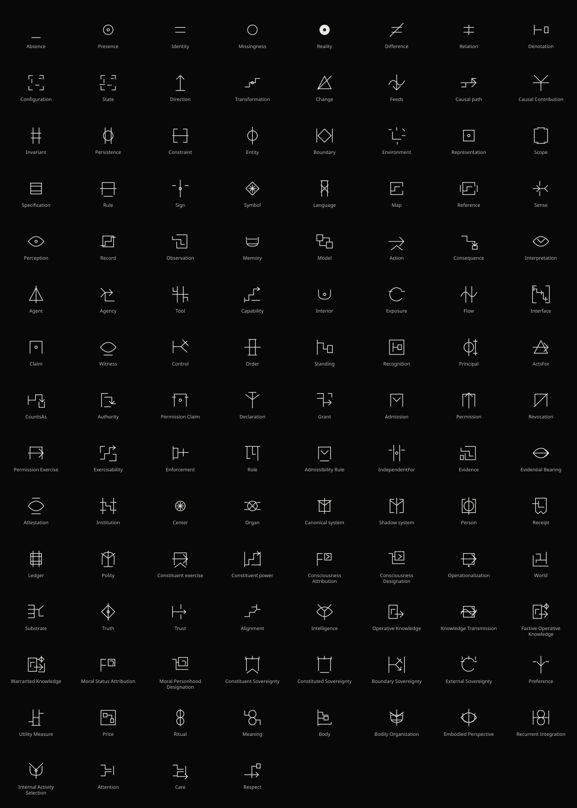

# Organon symbol review

Generated by `uv run scripts/build-glyph-font.py` from the shared catalog and semantic review. **Nonbinding; all marks remain provisional.**

Coverage: 118 marks; 49 retained trials, 69 revised trials, 0 awaiting redesign. Revised means changed, not approved. These are editorial judgments, not semantic proofs or reader-test results.

Reviewed against earlier definitions: Order, Configuration, State. Their entries may not match the current definitions.

[Installable TTF](./glyph-assets/OrganonSymbols.ttf) · [Webfont](./glyph-assets/OrganonSymbols.woff2) · [Source catalog](./glyph-catalog.mjs) · [Method](./unicode-vocabulary.md)

[Geometric rules](./glyph-geometry.json): 32-unit cell, equilateral triangle geometry, uniform 1.1-unit stroke, 1-unit ink margins, square caps and bounded miter joins. The integer grid and golden-section guides at 12/20 are advisory; derived vertices remain unsnapped until font-outline quantization.

Private-use characters work only with this font. Labels and Organon IDs remain authoritative; component shapes do not imply compositional meaning. Earlier Unicode candidates are historical alternatives, not a second active alphabet.

| Term | Font slot | Verdict | Cue | Risk | Recommendation |
| --- | --- | --- | --- | --- | --- |
| [Absence](../ontology/ontology.md#organon-absence) | U+E000 | revised | Standalone underscore: a minimal conventional name for absolute Absence, not a depiction. Its low placement concerns the inscription only; it asserts no position, ground, Boundary or Relation for Absence. Like every inscription, the mark is Presence under A4. | It can resemble an unfilled slot, underline, baseline or subtraction sign. An unfilled-slot reading would suggest Missingness and is not the justification for this choice. The reused foot stroke carries no consistent meaning across glyphs, and its occurrence elsewhere does not put Absence inside other terms. Its low position may be overlooked at small sizes. | Provisional underscore approved in pair_review, replacing the ring without changing the font slot. Retain its label and check tile, graph and mathematical text sizes. No dot-only exception is needed. Do not infer semantic equivalence or reader discrimination from its simplicity. |
| [Presence](../ontology/ontology.md#organon-presence) | U+E001 | trial | Unchanged ring with a central dot. Making a mark witnesses Presence under A4, but does not uniquely identify this glyph, since every inscription is Presence. | The ring may suggest a bounded Entity or a center in a field, neither required by A3. The circled dot also resembles solar and mathematical symbols and the historical Unicode Center candidate. | Retain the existing drawing and label. The circle is typographic, not an ontological enclosure. Design direction approved in pair_review; the underscore replacement for Absence removes the former dot-only opposition. No semantic equivalence or reader-test result is claimed. |
| [Identity](../ontology/ontology.md#organon-identity) | U+E073 | trial | Two parallel equal-length horizontal strokes: the conventional equals sign names logical equality within Presence (D120). It matches Difference's bars before the slash. The resemblance to two underscores is a poetic association, not an ontological construction. | May suggest only numerical equality, similarity, or an equation-solving instruction. The two strokes do not denote two distinct beings, two Absences, or a comparison event. Reusing bars in other glyphs does not assert compositional semantics. | Use provisionally with its label; distinguish exact Identity from resemblance and preserved properties. Keep the existing geometric bars motif and append a new font slot. Verify the symbol in tiles, graph and glyph mathematics. |
| [Missingness](../ontology/ontology.md#organon-missingness) | U+E002 | revised | Plain circle: an unfilled-field mnemonic, retaining Presence's ring without its central dot. The expected or represented item comes from A5, not from the shape alone. Missingness remains inside Presence, not absolute Absence. | The circle can read as zero, an empty set or an arbitrary empty container. Emptiness alone does not establish Missingness. The only visual difference from Presence is its central dot, so the pair can be confused at small sizes. | Provisional choice requested in field_review. Retain labels and check small-size discrimination from Presence; do not treat dot removal as a formal operation. This replaces frame+seed without changing the font slot or the definition. |
| [Reality](../ontology/ontology.md#organon-reality) | U+E003 | revised | Filled disk with a small clear center: an inverted-ink companion to Presence, using its circular outer contour. The filled area is a mnemonic for totality, not an exhaustive depiction of Presence. | The outer contour may suggest Reality is a bounded Entity; the hole may suggest Absence is a part of Reality. Neither inference is licensed. Negative space belongs to the inscription, not to absolute Absence. The opening can disappear at very small sizes, leaving a solid dot; the glyph can also resemble a washer or target. | Provisional choice requested in field_review, replacing the branching totality motif. Retain the label and check the central opening in the wall, inline math and graph. The drawing uses overlapping uniform strokes to make continuous ink; their layering carries no ontological meaning. |
| [Difference](../ontology/ontology.md#organon-difference) | U+E004 | trial | Two horizontal bars struck by a slash: a not-equals sign, now paired explicitly with Identity's equals sign. D002 negates Identity for the same compared Presences or ordered configurations. | Readings as numerical subtraction or inequality of magnitude. Shared bars in Memory, Ledger and Bodily Organization do not assert that those glyphs compose Identity. | Retain with label; the Identity/Difference partition is classical, not an empirical decision procedure. The slash is a mnemonic for this pair, not a general negation operator for the alphabet. |
| [Relation](../ontology/ontology.md#organon-relation) | U+E005 | revised | Two equal horizontal bars joined by a central vertical stroke, extending slightly beyond both bars: association with distinguishable participant positions, without an arrow or staircase. The bars share Identity's proportions but do not compose its meaning. | Resembles the double-dagger footnote mark. The equals-like bars may suggest that Relation requires Identity, while the vertical may be mistaken for another negation stroke alongside Difference. Two bars can suggest a binary-only relation and graphic symmetry can suggest reciprocity; none is required by D003. Ordered roles are not specified by the shape alone. | Provisional design approved in relation_review. Retain the label and compare with Identity and Difference at text size. The connecting stroke names association, not equality, causation or a general operation on glyph meanings. Interface retains the older ordered-path drawing; motif reuse is not a compositional grammar. |
| [Denotation](../ontology/ontology.md#organon-denotation) | U+E006 | revised | Maps-to: a vertical tail bar identifies the expression side, and a horizontal stem ends in a right-facing arrowhead toward the target side. Distinct graphic roles name expression-to-target reference without a detached box or gap. | Mathematical maps-to notation usually describes a function and may suggest one output per input; D102 does not require a unique target for an expression across uses. The arrow may suggest causation or transformation, neither entailed. A small tail can disappear at text size, leaving a generic arrow. | Provisional design approved in denotation_review. Use the custom shared-font drawing with its label. Borrow the expression-to-target orientation, not a function's uniqueness condition; Denotation establishes neither fidelity, Truth, Interpretation, institutional status nor participation in a Causal path. Check tail visibility at text and graph sizes. |
| [Set](../ontology/ontology.md#organon-set) | U+E074 | revised | Three solid dots arranged at equilateral triangle vertices: membership considered without asserting further Relations among the members. | Resembles the mathematical therefore sign. The layout might suggest exactly three members, spatial arrangement, or that a Set excludes Relations. None follows; empty Sets and Relation members remain permitted. | Use with its label, paired with Configuration. Triangle position is typographic, not member order. Test the solid dots at inline sizes. No reader study is claimed. |
| [Order](../ontology/ontology.md#organon-mathematical-order) | U+E075 | revised | Set's three dots joined along the two sloping sides, without a bottom edge: a Hasse-diagram mnemonic for a member Set with a partial order. Read upward, the lower pair is incomparable and each precedes the upper member; reflexive loops and transitive shortcuts are omitted. | May suggest exactly three members, a greatest member, mandatory branching or a hierarchy of authority. None is required: empty and total Orders remain permitted, and upward does not mean causation or improvement. The missing bottom edge can resemble an incomplete Configuration; it is not an ontological subtraction operation. | Provisional Hasse drawing approved in order_hasse_review, retaining U+E075. Use with the label Order and explain upward reading. Compare with Set, Configuration and State at text size; reader interpretation remains untested. |
| [Configuration](../ontology/ontology.md#organon-configuration) | U+E007 | revised | The same three dots as Set, joined by three straight lines: members together with specified relational structure. | May imply every member is connected, exactly three members, participant closure, or binary-only Relations. D004 requires none of these. Ordered participant roles are not shown. Resembles a triangular network and Change's plain delta. | Use provisionally with its label. The shared dots cue the member Set; the edges cue additional structure, not an exhaustive diagram. This supersedes the earlier alias reading. State now extends the triangle family with hollow/solid half-overlap, as recorded in state_overlap_review. |
| [State](../ontology/ontology.md#organon-state) | U+E008 | revised | Two equal upright Configuration-like triangles share a baseline with exactly half-base overlap: hollow vertices on the left, solid on the right. Each inner base node is at the midpoint of the other triangle's base, directly below its apex. A learned mnemonic for an indexed Configuration. | May suggest two successive States, a Transformation, or a past/present or possible/actual contrast. None is required; hollow vertices do not denote Missingness. The four-node baseline is crowded and hollow centers may disappear at small sizes. The drawing does not establish an index domain or its ordering. | Provisional midpoint-overlap drawing approved in state_overlap_review, retaining U+E008. Use with the State label. Compare with Configuration, Order and Change at text and graph sizes; reader interpretation remains untested. |
| [Direction](../ontology/ontology.md#organon-direction) | U+E009 | trial | Upward arrow standing on a baseline (foot): orientation away from a ground, cueing asymmetry (D006). | 'Up' now also marks only Permission, but it may still read as increase, elevation or improvement; Direction implies none of these, nor causality or chronology. | Retain with label; state that vertical orientation is arbitrary and confers no valence. |
| [Transformation](../ontology/ontology.md#organon-transformation) | U+E00A | revised | Two equilateral triangles share the upright ghost triangle's right edge, as after a 60-degree turn. The three ghost vertices stay hollow; only the new rightmost vertex is solid, cueing input-to-output orientation without a staircase. | May suggest spatial rotation, rigid motion, reversibility or necessarily preserved structure and participants. None is required. Hollow/solid does not mean Missingness/Presence or possible/actual; shared vertices do not assert identity of participants. The result is intentionally not a fully solid Configuration triangle. Hollow centers may close at text size. | Option A approved in transformation_edge_review, retaining U+E00A. Keep the label; compare the shared-edge silhouette with State's half-overlap and Configuration's single triangle. The turn is a learned mnemonic, not a semantic operation or reader-test evidence. |
| [Change](../ontology/ontology.md#organon-change) | U+E00B | revised | Plain equilateral triangle (delta), without a slash: the conventional finite-change cue for a Difference between States joined by a Transformation (D008). | Delta suggests numerical difference, but D008 is not restricted to quantities. The joining Transformation is not cued. Without nodes the delta resembles Configuration's triangle, and Agent and ActsFor now contain the whole Change glyph, so they may read as kinds of Change. | Option A approved in process_preservation_review, retaining U+E00B. Use with the Change label; delta is a conventional name, not a numerical restriction. Compare with Configuration, Agent and ActsFor at text size; the Agent family needs a separate redesign. |
| [Feeds](../ontology/ontology.md#organon-feeds) | U+E00C | revised | Member bridge: two disjoint equilateral triangles of hollow nodes; one bridge joins the first triangle's right base node to the second triangle's apex. A specified part of one State supplies a specified part of another (D009). | Direction is weak without an arrowhead; left-to-right, downward placement is only a convention. The bridge alone does not supply the required account and does not assert equality of the joined parts. The node groups name State roles, not full State glyphs, and may read as a molecule, network or two linked Configurations. Six hollow centers and short trimmed edges may close at text size. | Option A approved in process_preservation_review, retaining U+E00C. Use with the Feeds label. The study geometry is scaled by 0.95 about the cell center so the outer rings stay inside the ink margin; edges stop outside hollow centers. Check the bridge and hollow centers at inline sizes. |
| [Causal path](../ontology/ontology.md#organon-causal-path) | U+E00D | revised | Directed chain: three horizontal nodes joined in sequence, the first two hollow and the last solid, ending in a rightward arrowhead: ordered traversal sharing one orientation (D010). | A generic directed chain is not sufficient for a Causal path: the Transformations and Feeds joins are not shown. Hollow/solid does not mean possible/actual or past/present. It may read as a progress track, slider or playback control. Causal Contribution's lanes reuse the same row, so the two may be confused at small sizes. | Option B approved in process_preservation_review, superseding the earlier option D selection and retaining U+E00D. Use with the label; do not treat the chain as asserting the Feeds joins. Compare with Causal Contribution's lanes and generic arrows. |
| [Causal Contribution](../ontology/ontology.md#organon-causal-contribution) | U+E00E | revised | Comparison lanes: two parallel same-direction chains of three nodes with rightward arrowheads, the upper hollow throughout and the lower with solid first and last nodes. Two separately witnessed comparison paths with unlike endpoints (D103), not a fork. | Fill is a local contrast, not truth, actuality, Missingness or a measured effect. Matching inputs except one named Difference cannot be shown, and the downstream Change is not drawn separately. The lanes may read as two independent processes, parallel tracks or a control/treatment chart, and the lower lane resembles Causal path's chain. The upper arrowhead stops outside its hollow end node, so its tip is implied rather than drawn. | Option A approved in process_preservation_review, retaining U+E00E. Use with the label. It removes the fork's one-cause-two-effects and choice readings. Check the four hollow centers and the trimmed upper arrowhead at text size. |
| [Invariant](../ontology/ontology.md#organon-invariant) | U+E00F | revised | Two open 60-degree sectors around one filled pivot: three equal spokes end in hollow nodes, with no outer edges. A named element held while its surroundings vary under named Transformations (D011). | May read as a fan, hinge, compass or fixed-point rotation, suggesting pointwise or geometric invariance; D011 requires neither. The open sectors are not omitted Relations, and the filled pivot does not mean Presence or actuality. Persistence adds one sector, so the pair differs by one spoke at small sizes. Radiating spokes recall Center's wheel and the State and Transformation node graphs. | Two-sector open fan approved in process_preservation_review, retaining U+E00F. Use with the label; the named preserved part and Transformation family still need text. Compare with Persistence, Center and Transformation at text size. |
| [Persistence](../ontology/ontology.md#organon-persistence) | U+E010 | revised | Three open 60-degree sectors around one filled pivot: four equal spokes end in hollow nodes, with no outer edges. Invariant's pivot extended through one more sector: an Invariant preserved across an ordered sequence of States (D012). | Sector count is a drawing choice; it does not fix the number of States or show their order. The half-fan may read as a sunrise, gauge or fan. It differs from Invariant by one spoke, which may be lost at small sizes, and shares Invariant's fixed-point and Center's hub readings. Varying State Configurations are permitted but not shown. | Three open sectors (option A) approved in process_preservation_review, retaining U+E010; the closed-sector alternative was not adopted. Use with the label and compare with Invariant and Center at text size. |
| [Constraint](../ontology/ontology.md#organon-constraint) | U+E011 | revised | Selective branch: one input splits into a route that continues to a corner arrowhead and a route that meets a transverse stop. A persistent Relation excluding some Transformations while permitting others (D013). | The fork can imply an Agent choosing, though Constraints need no Agent; it resembles Control's routing junction and the remaining fork glyphs (Intelligence, Internal Activity Selection). The stop is not Absence or Revocation. Persistence is not shown. It may read as Permission plus Revocation or as a railway switch. | Option B approved in process_preservation_review, retaining U+E011. Use with the label. It removes the earlier closeness to Rule and Scope's frame. Compare with Control, Boundary Sovereignty and Substrate at text size. |
| [Entity](../ontology/ontology.md#organon-entity) | U+E012 | revised | Six equal 12-unit spokes from one solid pivot at the cell center, every 60 degrees, each ending in its own hollow node, with no outer hexagon: the Invariant and Persistence pivot fan carried around the full turn. A Presence reidentified across ordered States through a named Invariant and Persistence witness (D014). | Identity is not the six endpoints: the spokes are not six States, a complete or exhaustive history, or a causal network, and the full turn is a family resemblance, not completeness. The solid pivot does not mean Presence or actuality; hollow endpoints do not mean Missingness, and the open sectors are not omitted Relations. It may read as an asterisk, snowflake, hub or wheel, recalling Center's and Symbol's star. Principal and Person keep the former ring-and-axis form, so the Entity family is visibly broken; they remain Entities by definition (D049, D073), not by drawing. | Six-sector open fan approved in identity_expression_review, retaining U+E012. Use with the label; the named Invariant, ordered States and Persistence witness still need text. Compare with Persistence, Invariant, Center and Symbol at text size. Repairing the Principal and Person family needs a separate review. |
| [Boundary](../ontology/ontology.md#organon-boundary) | U+E013 | trial | Diamond flanked by two outer vertical strokes (echo): a delimited outline set off from surroundings. | Reads as absolute-value/norm bars around a diamond. The diamond is shared with Symbol and Truth, so Boundary may read as truth-like or symbolic rather than D015's Constraints indexed to an identity Invariant. Echo also appears in Recurrent Integration and Constituent Power, and Boundary Sovereignty and Reference use similar outer strokes, so the outer bars have no stable Boundary meaning. Interface and Sense, both defined through Boundary, do not reuse this form. | Retained by Daniel's choice in identity_expression_review, superseding the tentative selective-perimeter proposal. Use with label; note that Boundary need not be geometric. |
| [Environment](../ontology/ontology.md#organon-environment) | U+E014 | revised | External set (option C): a box with a solid node, joined by an unarrowed connector to a separate bracket grouping three hollow outside members: Presence related to an Entity but not included in the identity delimited by its Boundary (D016). | Inclusion is not spatial: the box is not a physical container or a drawing of the Boundary, and outside placement is typographic. Three members are not required. The connector has no arrowhead and asserts no causal flow or entry. It may resemble Feeds, a network or a tree bracket; hollow members do not mean Missingness. The bracket recalls Scope's spans, and the box recalls Sign's token box. | Option C approved in identity_expression_review, retaining U+E014; it replaces the corner-and-dashes revision, whose surroundings stroke stays unused. Use with the label. Compare with Feeds, Scope, Sign and World at text size. |
| [Representation](../ontology/ontology.md#organon-representation) | U+E015 | trial | Square with a central dot: a framed stand-in for a point (expression position, D017). | Differs from Claim (gate+dot) only by the bottom edge; nothing marks non-identity with the target. Specification and Rule now use a full-height sheet and Sign a token box, so none reuses the square and dot. | Retained by Daniel's choice in identity_expression_review, superseding the tentative expression-stem proposal. Use with label; keep the square-dot form for Representation. |
| [Scope](../ontology/ontology.md#organon-scope) | U+E016 | revised | Coverage span: open upper and lower spans over three solid member dots: the set of Presences, Relations, States or Transformations to which a Representation or Constraint applies (D018). | Three dots force neither three members nor a nonempty Scope; empty Scopes remain possible. The spans may read as a container, a horizontal range or an ordering, though Scope need not be spatial or ordered. The dots recall Set's members, but the glyph does not compose Set with brackets. The open spans resemble Environment's bracket and generic frame corners such as Warranted Knowledge's. | Coverage span approved in identity_expression_review, retaining U+E016. Use with the label; the governing Representation or Constraint is not drawn. Compare with Set, Environment, Shadow system and Interface at text size. |
| [Specification](../ontology/ontology.md#organon-specification) | U+E017 | revised | Test sheet: a full-height sheet containing a condition line and a route that turns to meet a transverse result mark: a Representation that identifies a Scope and supplies a constructive decision procedure for membership or conformity (D019). | Constructivity cannot be inferred from the sheet: the route depicts a test, not an effective procedure, and a classical predicate drawn the same way would not thereby be a Specification. The transverse mark may read as a check, cross or Constraint's stop; it is not Absence, Revocation or rejection. The drawing is document-like and dense, with the result mark about 0.7 unit from the sheet edge. Rule shares the sheet; Representation keeps its square and dot. | Test sheet approved in identity_expression_review, retaining U+E017. Use with the label; the Scope and decision procedure must be supplied in prose. Compare with Rule, Map, Record, Ledger and Constraint at text size. |
| [Rule](../ontology/ontology.md#organon-rule) | U+E018 | revised | Mapping sheet: Specification's full-height sheet containing a maps-to expression (tail bar, stem and symmetric 3-unit arrowhead): a Specification of a Constraint or Transformation that maps conforming inputs to a set of outputs (D020). | Maps-to borrows input-to-output orientation only: a Rule need not be a function, deterministic or yield a unique output, and its output set may be plural. The arrow asserts no causation. It may read as an export, send or forward button. The inner maps-to recalls Denotation, but a Rule is not a Denotation; the shared sheet with Specification cues D020's dependency, not composition. | Mapping sheet approved in identity_expression_review, retaining U+E018. Use with the label; the conformity condition and output set are not drawn. Compare with Denotation, Specification and Operationalization at text size. |
| [Sign](../ontology/ontology.md#organon-sign) | U+E019 | revised | Trace into token: a hollow target node, an arrow with a symmetric 3-unit head, and a separate token box: a Representation joined to its target by a Causal path ending in the State that contains it (D021). | The target-to-token arrow is the causal trace direction, not Denotation's orientation, which runs from expression to target; it reverses the maps-to reading. An arrow does not confer causal status, and a merely assigned Denotation is not a trace. It may read as machine input, a plug or a download. The hollow node does not mean Missingness. Square caps make the arrow touch the node ring and box, so the glyph is one connected outline. | Trace into token approved in identity_expression_review, retaining U+E019. Use with the label and state the direction relative to Denotation. Compare with Causal path, Denotation, Environment and Knowledge Transmission at text size. |
| [Symbol](../ontology/ontology.md#organon-symbol) | U+E01A | trial | Diamond containing an eight-spoke asterisk (sparkle). | Decorative 'special/magic' sparkle; shares star with Center, implying a concentration hub. Not in the Representation family despite D022. Persistence under a Rule is not cued. | Explicitly retained in expression_recording_review. The diamond's use remains deferred; state that the star is decorative. |
| [Language](../ontology/ontology.md#organon-language) | U+E01B | revised | Rewrite network: one token box branches through two directed connections toward two expression boxes, cueing a system of transformations of Symbols under Rules (D023). | May read as a generic flowchart, Model or Control. The boxes do not reproduce Symbol's diamond, and the arrows neither establish Rules nor assert causality. One input and two outputs are not required; Persistence and coordination remain implicit. | Option C approved in expression_recording_review, retaining its slot. Keep the label; inspect small boxes and arrowheads at inline sizes. |
| [Map](../ontology/ontology.md#organon-map) | U+E01C | revised | Uneven mesh: a skew quadrilateral with crossing diagonals and a horizontal crossbar, cueing an organized comparison surface with distortions (D024). | Geometric distortion is only a mnemonic: Maps need not be spatial, meshes or quantitative models. Its irregular triangular cells are not Configuration triangles. Dense crossings can resemble a crossed-out box or envelope. Reference still uses the former partial sheet, so that visual family is broken pending review. | Option D approved in expression_recording_review, retaining its slot. Keep the label; inspect mesh junctions at inline sizes and compare with Canonical system. |
| [Reference](../ontology/ontology.md#organon-reference) | U+E01D | revised | The former partial-Map sheet between two short outer comparison bars. | The bars resemble absolute-value/norm bars, Boundary and Constituent Power. The paired Specification of Scope, Constraints and enumerated distortions (D025) is only stipulated. Map now uses an uneven mesh, so Reference no longer contains its current glyph. It remains close to Evidence's traced sheet. | New proposals requested in expression_recording_review. Keep this drawing unchanged until a replacement is approved; do not automatically replace its shared partialMap stroke. |
| [Sense](../ontology/ontology.md#organon-sense) | U+E01E | revised | Revised: a horizontal path crossing a vertical barrier through a gap, with a chevron marking entry at the gap and a splayed end inside: Differences admitted through a Boundary into a path. | The arrow-through-gapped-barrier template is nearly the same as Trust's, inviting Sense/Trust conflation. The barrier is generic and does not reuse the Boundary (diamond+echo) or Constraint forms. The splayed end may read as arrow fletching, a crosshair or a broadcast. The chevron is a mnemonic and does not assert a Causal path (D026). | Revised trial awaiting review. It addresses the crescent derived from Absence: Sense no longer shares the Absence form. Differentiate it from Trust and consider tying the barrier to the Boundary family. |
| [Perception](../ontology/ontology.md#organon-perception) | U+E01F | trial | Eye with central pupil dot: an internal state produced through sensing. | Imports vision specifically; Sense and Perception need not be visual. Observation now uses a smaller eye inside a sheet, so the two share an eye again. Sense's proposed bar-and-eye is not yet adopted. | Retained with label; legend should state the eye is not visual-only. Compare with Observation at small sizes. |
| [Record](../ontology/ontology.md#organon-record) | U+E020 | revised | Retained token: a rectangular sheet containing a hollow circle above one short retention line, extending Representation's square and hollow circle (D028). | May read as an ID card or document. Persistence and reference to an earlier State, Relation or Change cannot be inferred from the line. It is not Absence or a universal retention operator. Observation shares the sheet but uses an eye instead; Evidence keeps the older traced sheet. | Option B approved in expression_recording_review, retaining its slot. Use with the label and compare with Representation, Specification and Observation. |
| [Observation](../ontology/ontology.md#organon-observation) | U+E021 | revised | Witnessed record: a square sheet enclosing a small eye with a hollow pupil, joining the sheet and retained eye families (D029). | The study name does not require a Witness: Observation needs neither vision nor a conscious observer. The specified Environment-to-Sense production path is not drawn. The eye asserts neither Truth nor independence, and Observation is not Reality itself. It may read as surveillance or a viewed document. Evidence keeps the former traced-record form, breaking their visual family. | Option D approved in expression_recording_review, retaining its slot. Keep the label; compare with Perception and Representation at inline sizes. Do not add Record's retention line without another review. |
| [Memory](../ontology/ontology.md#organon-memory) | U+E022 | trial | Open vessel holding two horizontal bars: stored lines inside an interior (D030). | Bars read as '=' inside a cup; Bodily Organization is Memory plus a tree, implying organization is stored memory. | Retain with label. |
| [Model](../ontology/ontology.md#organon-model) | U+E023 | revised | Revised: two squares (Representations) joined by two stepped connectors in a loop: an organized Configuration of Representations and Transformations. | It may read as a flowchart, a 'duplicate/copy' icon or a chain link, and the looped connectors may read as recurrence (Recurrent Integration) or feedback. Perception, Memory, later States and stated Constraints (D031) are not distinguished, so it may read as just two linked records. Revised Price (two linked small squares inside a record frame) is close to it. | Revised trial awaiting review. It addresses the octagram (religious and compass emblem) and the diamond tie to Truth/CountsAs/Price. Test against copy/duplicate UI readings. |
| [Action](../ontology/ontology.md#organon-action) | U+E024 | trial | Rightward arrow above two splayed strokes (roots/legs): outward movement. | Legs import bodily locomotion; D032 requires a Transformation across a Boundary from an internal state, not motion or a body. Legs now remain only here and in Constituent Exercise and Constituent Sovereignty. The arrow stroke is the generic arrow shared with Permission Exercise and others; revised Agency uses a different arrow, so the Agency-Action link is only approximate. | Retain with label; consider dropping the legs. |
| [Consequence](../ontology/ontology.md#organon-consequence) | U+E025 | revised | Revised: a descending stepped path ending in a downward arrowhead whose tip meets the top edge of a closed endpoint box: a Change at the end of a path. | Arrow-into-box may read as download, save or 'put in', and the box as a container rather than a Change. A similar small box marks admission in Evidence, so the box has no stable meaning. The form is close to CountsAs (stepped path, downward arrowhead, lower-right box; CountsAs adds a post and leaves its slot open). The path start does not mark an originating Action (D033). The arrowhead is a mnemonic order cue, not a causal proof. | Revised trial awaiting review. It addresses the vessel (entering an interior) and psi readings, the Grant superset, and the earlier detached end square. Separate it from CountsAs in small-size testing. |
| [Interpretation](../ontology/ontology.md#organon-interpretation) | U+E026 | trial | Eye with a downward chevron inside: perception narrowed to a selection. | Chevron is reused in Admission, Admissibility Rule and Preference with checkmark-like readings; the joining to available Actions (D034) is only weakly cued. Revised Agency uses a different, sideways chevron, so Agency does not visibly inherit this glyph. | Retain as a learned alias with label; state chevron is arbitrary. |
| [Agent](../ontology/ontology.md#organon-agent) | U+E027 | revised | Equilateral triangle on a full vertical axis (tent/letter A): an entity with an orienting axis. | Contains Change's whole plain delta plus an axis, so it may read as a kind of Change, a warning sign or a rocket. Agency is no longer a humanoid figure, so the earlier inversion is resolved, and Agent no longer shares any element with Agency. Entity now uses the six-sector fan, so Agent's axis no longer links it to Entity's glyph. | Retain with label. |
| [Agency](../ontology/ontology.md#organon-agency) | U+E028 | revised | Revised: a sideways chevron (Interpretation) joined at one junction to a rightward arrow (Action) and a lower L branch: a Relation between Interpretation and the selection or production of Action. | The chevron is not the Interpretation glyph's motif (eye with a downward chevron), so the Interpretation link is stipulated. '>' plus an underline can read as a command-line prompt, 'next' or fast-forward. Nothing marks the interpretation as the Agent's own (D036). | Revised trial awaiting review. It addresses the stick figure, the Entity superset and the humanoid inversion relative to Agent: no ring, axis or legs remain. Consider borrowing a visible element of the Interpretation glyph. |
| [Tool](../ontology/ontology.md#organon-tool) | U+E029 | trial | Two rails with a crossbar (H) plus corner hooks at opposite corners: an attachable implement. | Hooks are arbitrary; rails tie Tool to Order and the other rail glyphs. The 'incorporated but not identity' condition (D037) is not legible. | Retain as an explicitly arbitrary learned alias with label. |
| [Capability](../ontology/ontology.md#organon-capability) | U+E02A | revised | Revised: an ascending staircase from a ground tick to an arrowhead, over a base line: a specified path by which an Action can be produced under stated Constraints. | Staircase plus arrowhead reads as growth, progress or 'level up', importing a desirability that D038 denies. Causal path now uses a directed node chain, but the arrowhead may still make a relative possibility read as an actual completed path. The Constraint interpretation and the witnessing Configuration are not legible. | Revised trial awaiting review. It addresses the arch-versus-gate template shared with Permission (U1, Pj1–Pj2, C7): Capability no longer shares a base or arrow form with Permission. The legend should call the ascent arbitrary. Consider a possibility cue that separates it from actual paths. |
| [Interior](../ontology/ontology.md#organon-interior) | U+E02B | trial | Open vessel containing a dot: something held within a boundary (D039). | Internal Activity Selection is a superset, importing interior-protection readings into it; Respect no longer is. | Retain with label. |
| [Exposure](../ontology/ontology.md#organon-exposure) | U+E02C | trial | Open arc with short side ticks: an opening through which something passes out. | Shares open with External Sovereignty, which becomes Exposure plus a crown. Reference retains the former Map's side gap, which may read as an exposure cue; Map itself no longer has that gap. | Retain with label. |
| [Flow](../ontology/ontology.md#organon-flow) | U+E02D | trial | Wave crossing two rails: repeated movement along persistent tracks (D041). | Wave also in Knowledge Transmission; may suggest fluid or periodicity, which D041 does not require. | Retain with label; note periodicity is not implied. |
| [Interface](../ontology/ontology.md#organon-interface) | U+E02E | revised | Revised as a linked family member: the Relation's ordered-position path inside wide open brackets (portFrame, at x=2 and x=30), an explicitly represented, ordered set of permitted Transformations within a constrained boundary. | Widening the brackets and moving their arms to y=2/30 removes the earlier stroke contacts. Remaining gaps are narrow: about 0.9 unit clear beside and above the start tick and 1.9 units below the last tick. The glyph may still look crowded at small sizes. The brackets resemble Shadow system's frame and, more loosely, Scope's coverage spans, not Boundary's diamond+echo, though D042 makes Interface a Boundary. Coordination between Entities is not shown. | Revised trial awaiting review. It addresses the inherited symmetric link and stroke collisions. Check separation at text sizes and consider a Boundary-family enclosure. |
| [Claim](../ontology/ontology.md#organon-claim) | U+E02F | trial | Square gate with a central dot: a representation placed in an assertive frame. | Gate is the institutional/Permission family, suggesting Claims are institutional; D043 needs only an asserting Agent. Differs from Representation by one edge. The revised Consciousness and Moral Status Attribution glyphs, both Claims, use an assertion flag instead of this form. | Retain with label; keep the Representation family link explicit in the legend. |
| [Witness](../ontology/ontology.md#organon-witness) | U+E030 | trial | Eye on a baseline: an observer standing apart. | Imports human visual seeing; D044's distinctness from the claimant and the produced Observation are not shown, and the foot is arbitrary. Observation again shares an eye, but that resemblance does not make every Observation witnessed. | Retain with label. |
| [Control](../ontology/ontology.md#organon-control) | U+E031 | revised | Revised: a source post with a line to a junction that splits into two branches, one crossed by a slash: an Agent's Actions configuring, routing or blocking a process's outputs. | The K-shape with an X on one branch emphasizes prevention or prohibition, though D045 also covers configuring, bypassing and determining outputs. The diverging branches resemble fork (choice; Intelligence, Internal Activity Selection) and Constraint's selective branch. The same junction-and-branches template appears in Boundary Sovereignty (appropriate, since it requires Control) and in Substrate. | Revised trial awaiting review. It addresses the gate family and the near-collision with Permission by arrow direction: Control is now a mechanical routing mark outside the institutional motifs, supporting the separation from Authority that D065 relies on. Check against Substrate. |
| [Coordination Order](../ontology/ontology.md#organon-order) | U+E032 | trial | Two rails with crossbar, top cap and bottom foot: a lattice or ladder of persistent structure for coordination. This legacy key now has the label Coordination Order, retaining D046 and its font slot. | Close to Language and Institution; shared rails do not turn coordination into a mathematical partial order. Role and Authority use a frame cue this glyph does not share. | Retain with the explicit Coordination Order label. Do not reuse this slot for mathematical Order. |
| [Standing](../ontology/ontology.md#organon-standing) | U+E033 | revised | Revised: a full-height post on the left from which a stepped stem descends to join the left side of a box: an Order placing an Entity within a domain of statuses. There is no top bar. | Without a top bar the earlier gallows/signpost reading no longer applies, but post-plus-stepped-connector-plus-box may read as a flowchart connector, a flag or a plug. The step may read as descent or demotion. It is close to Recognition (post, stem and box inside a closed square) and to Body. The Order is carried only by the bare post, by stipulation, and the Rule, Scope and status are not distinguished. | Revised trial awaiting review. It addresses the 'standing upright' pun (double dagger), the near-collision with Order's lattice and the earlier gallows top bar. Keep the open-placement versus closed-square contrast with Recognition legible, since D047 says placement is not recording. |
| [Recognition](../ontology/ontology.md#organon-recognition) | U+E034 | revised | Revised: a smaller placement (post, straight stem, box) enclosed in a closed square: Standing recorded by an Order. Its stem is straight, unlike Standing's stepped stem. | It may read as an ID card, form field or toggle widget, and enclosure-as-record is a stipulation. Because the inner stem is straight rather than stepped, the link to Standing rests on the post-stem-box template rather than an exact copy. Matching at exactly the same indices (D048) is not legible. The post-stem-box template also occurs in the Designation glyphs; D081 says Designation does not reuse Recognition, and the two are now similar in template though not identical. | Revised trial awaiting review. It addresses the eye-with-eyelashes look and the crown (monarchy, implied Authority). Keep it distinct from Standing and from the Designation forms in testing. |
| [Principal](../ontology/ontology.md#organon-principal) | U+E035 | revised | Revised: the former Entity glyph (ring on axis) beside a serifed vertical bar marking a party position: an Entity with Standing to serve as the party on whose behalf Actions count. | The party bar reads as an I-beam, text cursor or ruler and does not reuse the revised Standing placement motif, so the Standing link (D049) is stipulated. Ring+axis keeps the phi/diameter readings; Entity now uses the six-sector fan, so this family link is broken and Principal's Entity status is not drawn. Order indexing is not shown. | Revised trial awaiting review. It addresses the warning-sign triangle and the Agent family: the glyph now shows an Entity, not necessarily an Agent. |
| [ActsFor](../ontology/ontology.md#organon-acts-for) | U+E036 | revised | Equilateral triangle pierced by a horizontal arrow: an agent oriented on behalf of another. | Only the Agent triangle, also Change's whole delta, appears. Principal is drawn as ring+axis plus a party bar, so the Principal position is entirely absent from this glyph; the arrow is the generic causal arrow. | Retain with label. |
| [CountsAs](../ontology/ontology.md#organon-counts-as) | U+E037 | revised | Revised: an Order post with a path that rises one step, runs right and turns down into a downward arrowhead whose tip enters the mouth of an open-topped status slot: an Order-indexed assignment of status. | Arrow-into-slot may read as dropping a token into a box, download or a ballot, and the arrow may read as causal transfer, though CountsAs (D051) records a status. The form is close to Consequence (stepped path, downward arrowhead, lower-right box), differing mainly by the post and the open slot. Admission and the two Designations, all CountsAs Relations, do not reuse this form. | Revised trial awaiting review. It addresses the equals-in-diamond identity reading (the rejected Unicode cue), the diamond tie to Truth, Price and State, and the earlier arrow that pointed away from its slot. Separate it from Consequence in small-size testing. |
| [Authority](../ontology/ontology.md#organon-authority) | U+E038 | revised | Revised: an Order frame (left post and top bar) with an inner path that turns down through an arrowhead before continuing, over a base: an Agent's Action entering CountsAs as binding. | The downward arrow may read as top-down command or imposition, a download icon or a return/enter key, and 'binding' and the Principal are not legible. The arrowhead sits at a corner, so direction is ambiguous. Constituted Sovereignty, which requires Authority (D096), no longer shares any form with it. | Revised trial awaiting review. It addresses the crown (monarchy/supremacy), the crown/axis stroke merge and the near-identity with Constituted Sovereignty. Test against command and download readings. |
| [Permission Claim](../ontology/ontology.md#organon-permission-claim) | U+E039 | trial | Claim (gate+dot) plus side wings: a claim extended outward to an allowed agent. | Wings have no stable meaning across five runes; Claim plus wings could be confused with Permission itself. | Retain with label; state wings are arbitrary. |
| [Declaration](../ontology/ontology.md#organon-declaration) | U+E03A | trial | Branching tree (Y on stem) with a top cap: a statement issued outward/announced. | Tree is shared with Canonical/Shadow system, Polity and Bodily Organization; renders psi-like. No cue of Authority or submission to an Order. Revised Grant and the attribution glyphs do not reuse it, although Grant is a Declaration. Largely arbitrary. | Retain as an arbitrary learned alias with label. |
| [Grant](../ontology/ontology.md#organon-grant) | U+E03B | revised | Revised: a flag-like post with a top bar and mid crossbar, an arrow leaving the post to the right, and a small corner mark at upper right: an issued permission. | The outward arrow still suggests handing over or transferring possession, which D055 does not mean. The glyph shares no element with the Declaration glyph (tree+cap) or the Permission glyph (gate+up), so 'a Declaration whose Claim is a Permission Claim under covering Authority' has no visual link; the corner mark is a weak, generic token. | Revised trial awaiting review. It addresses the pouring-into-a-cup gift image and the Consequence superset. The earlier recommendation to work within the Declaration/Permission families is still unmet. |
| [Admission](../ontology/ontology.md#organon-admission) | U+E03C | trial | Square gate with a downward chevron: a check mark in a box, accepted for an institutional purpose. | Checkbox implies approval or truth; C14/D085 note Admission can preserve a false Claim. Close to Admissibility Rule (+foot). Revised Evidence and the Designations, which involve Admission, do not reuse this form. | Retain with label stating acceptance is not correctness. |
| [Permission](../ontology/ontology.md#organon-permission) | U+E03D | trial | Square gate with upward arrow: passage opened upward. | No longer near-identical to Capability or Control, which were redrawn. The up arrow may still read as increase. Grant and Exercisability, which involve Permission, do not visibly reuse the gate+up form. | Retain with label. |
| [Revocation](../ontology/ontology.md#organon-revocation) | U+E03E | trial | Square gate struck by a diagonal slash: a governed passage cancelled. | Slash also means Difference; may read as 'prohibited' rather than ceasing admission from a stated time (D058). | Retain with label. |
| [Permission Exercise](../ontology/ontology.md#organon-permission-exercise) | U+E03F | trial | Square gate with an arrow passing through: action moving through a permitted passage. | No longer confusable with Exercisability, which now uses the Capability staircase. Constituent Exercise is this glyph plus legs, which may imply that it is a Permission Exercise. | Retain with label. |
| [Exercisability](../ontology/ontology.md#organon-exercisability) | U+E040 | revised | Revised: the Capability staircase-and-arrow framed by corner brackets at upper left and lower right: an Action realizable by Capability within a Permission's scope and interval. | The Permission component is only two generic corners, which read as a frame or a 'maximize/fullscreen' icon rather than the Permission (gate) glyph. The time and the governing Order's continuing admission (D060) are not legible. It inherits Capability's progress and Causal-path readings. | Revised trial awaiting review. It addresses the arch-versus-gate confusion with Permission Exercise, and the Capability component is now visible. Make the Permission component recognizably Permission. |
| [Enforcement](../ontology/ontology.md#organon-enforcement) | U+E041 | revised | Revised: an Order post from which two branches (satisfied and violated) converge on a junction, pass a coupling bar and continue to an output: an Order coupling a Rule to Constraints, Records or Consequences in either case. | It may read as an electrical plug, a capacitor or a merge symbol, and the coupling bar may read as a stop or barrier. The Rule glyph (mapping sheet) is not reused. The converging-pair-to-bar template resembles Attention and Care. | Revised trial awaiting review. It addresses the X (prohibition/punishment) and the near-identity with Configuration. Separate it from Attention in testing. |
| [Role](../ontology/ontology.md#organon-role) | U+E042 | revised | Revised: an Order bar with three hanging strands of different lengths, two ending in hooks: a persistent Order-indexed bundle of Actions, Permissions, Authority and Consequences assigned under Standing. | It may read as a coat rack, comb, bar chart or Π. The strands are undifferentiated (three strands for four components) and the assigned Agent is not shown. Revised Standing has no top bar and Role does not reuse the Standing placement, so 'assigned under Standing' is not visually linked; the top bar is shared only loosely with Authority's frame. | Revised trial awaiting review. It addresses the arch (Capability family, against Pj2) and the resemblance to Rule. |
| [Admissibility Rule](../ontology/ontology.md#organon-admissibility-rule) | U+E043 | trial | Admission (gate+chevron) on a baseline foot: the grounded rule behind admission. | Differs from Admission only by the arbitrary foot; Receipt has been redrawn and no longer resembles it. Provenance inspectability (D064) is not cued. | Retain with label; consider a stronger differentiator from Admission. |
| [IndependentFor](../ontology/ontology.md#organon-independent-for) | U+E044 | trial | A dot isolated between two rails with side wings: something kept apart from surrounding control. | Sign no longer uses axis+dot+wings, so the earlier resemblance is gone; the two independence conditions of D065 are not distinguished. | Retain with label. |
| [Evidence](../ontology/ontology.md#organon-evidence) | U+E045 | revised | The former Observation traced-record form plus a small square marker at lower left: an Observation admitted under a Rule. | The small admission marker may vanish at inline sizes, does not reuse Admission and resembles Consequence's endpoint. Witness and IndependentFor (D066) are not shown. Observation now uses an enclosed eye, so their visual family is broken; Evidence remains close to Reference's partial sheet. | Retain this drawing pending separate approval. The earlier equals-in-eye 'seen equals true' risk remains avoided, but Evidence no longer contains the current Observation drawing. Strengthen the admission marker in its own review. |
| [Evidential Bearing](../ontology/ontology.md#organon-evidential-bearing) | U+E046 | trial | Eye pierced by a horizontal arrow: evidence pointing toward a claim. | Single arrow suggests support only; D104 includes defeating and underdetermining dispositions. Arrow is the causal arrow. Evidence is now a Record-family glyph, so this eye no longer echoes the Evidence form it relates. | Retain with label stating the disposition must be labelled separately; consider aligning with the revised Evidence form. |
| [Attestation](../ontology/ontology.md#organon-attestation) | U+E047 | trial | Eye between a top cap and bottom foot: an observer set in a formal slot. | Attestation is a Claim (D067) but the rune lacks the Claim gate; cap and foot are arbitrary. Its eye again resembles Observation but not Evidence. | Retain with label. |
| [Institution](../ontology/ontology.md#organon-institution) | U+E048 | revised | Revised: two full rails (persistence) crossed by a stepped path and two crossbars: an Order persisting while what passes through it changes. | A dense lattice resembling Order, Ledger, a railway or a ladder; the step may read as progress or Transformation. 'Despite changes in participating Agents' and the Roles, Records, Interfaces and Flows (D068) are not legible. Rails suggest Persistence only by stipulation. | Revised trial awaiting review. It addresses the crown (ruler/sovereign). Test distinctness from Order and Ledger. |
| [Center](../ontology/ontology.md#organon-center) | U+E049 | trial | Ring with eight radiating spokes: a hub where flows converge and from which constraints radiate (D069). | Wheel/helm/sun and dharma-wheel readings; hub imagery can suggest a controlling planner, which D069 disclaims. | Retain with label stating a Center need not be an Agent. |
| [Organ](../ontology/ontology.md#organon-organ) | U+E04A | trial | Ring with an X and four side ticks: a gear-like specialized part performing recurring work. | Circled X reads as cancel/tensor product; 'organ' may suggest biology, which D070 does not require. | Retain with label. |
| [Canonical system](../ontology/ontology.md#organon-canonical-system) | U+E04B | trial | Closed square containing a branching tree: an official enclosed structure. | Renders like an envelope (mail) icon; does not use Map's uneven mesh though D071 makes it a Map. The closed/open contrast with Shadow system is a useful learned cue. | Retain with label, paired with Shadow system. |
| [Shadow system](../ontology/ontology.md#organon-shadow-system) | U+E04C | trial | Open brackets containing the same tree: structure operating outside the closed official frame. | Scope no longer uses the frame, but it may still read as a scoped or constrained system rather than one excluded from the Canonical system yet required (D072). | Retain with label, always shown alongside Canonical system. |
| [Person](../ontology/ontology.md#organon-person) | U+E04D | revised | Revised: the former Entity glyph (ring on axis) inside an open-topped record box with corner stubs: an Entity for which an Order records Standing. | It may read as a phi in a bin or cup (recalling vessel), a power symbol or a null/diameter sign. The record box is not Recognition's closed square, so recorded Standing is a separate stipulation. Serving as Principal is not distinguished from bearing Consequences (D073). Entity now uses the six-sector fan, so the ring and axis no longer show Person's Entity status; the family is broken. | Revised trial awaiting review. It addresses the stick figure with a hat (biological, conscious and Agent readings that D073 denies). Consider aligning the record frame with the Recognition form. |
| [Receipt](../ontology/ontology.md#organon-receipt) | U+E04E | revised | Revised: a slip with a torn zigzag bottom, entered from the left by a stepped path: a portable Record relating an Action to its context. | A torn till slip is a strong shopping/payment image that may import purchase and Price. D074's Agent, Authority, Permission, Scope and observed Consequence are not distinguished. | Revised trial awaiting review. It addresses the checkbox and the near-identity with Admission and Admissibility Rule. Test the commercial reading and label it as an action record. |
| [Ledger](../ontology/ontology.md#organon-ledger) | U+E04F | trial | Closed square with an internal grid (rails and bars): a ruled table of typed records (D075). | Specification no longer uses square+bars, so the earlier superset is gone; Invariant no longer uses the hash; resembles the Unicode study's Model candidate (squared grid). Revised Price, which D101 records in a Ledger, does not reuse this form. | Retain with label; resolve the grid collision in the shared font. |
| [Polity](../ontology/ontology.md#organon-polity) | U+E050 | trial | Rounded arch over a branching tree on a baseline: a plural structure under a common canopy. | The arch is now unique to Polity, so the Capability association is gone; it may still read as a capitol building or as a single organized body rather than a contested plurality (D076). Revised Constituent Power, a Capability of a Polity, does not reuse this form. | Retain with label. |
| [Constituent exercise](../ontology/ontology.md#organon-constituent-exercise) | U+E051 | trial | Square gate pierced by an arrow, with legs below: action passing through and transforming the Order. | Legs import a humanoid/popular-crowd reading; D078 is Agency whose Actions transform the Order, not necessarily a people. It is Permission Exercise plus legs, which may imply prior Permission, and it no longer shares a form with revised Agency or Constituent Power. | Retain with label; consider dropping the legs now that the humanoid figures elsewhere were removed. |
| [Constituent power](../ontology/ontology.md#organon-constituent-power) | U+E052 | revised | Revised as a linked family member: the Capability staircase-and-arrow between two full outer bars, a persistent Capability of a Polity. | The outer bars are echo, also used in Boundary and Recurrent Integration and similar to Reference's comparison bars, so their meaning here is arbitrary. The Polity glyph (arch+tree+foot) is not reused. Constituent Exercise and Constituent Sovereignty keep gate and legs, so the constituent family is split visually. It inherits Capability's progress reading. | Revised trial awaiting review. It addresses the inherited Capability/Permission confusion and the humanoid legs. Align the constituent family once the remaining legs are resolved. |
| [Consciousness Attribution](../ontology/ontology.md#organon-consciousness-attribution) | U+E053 | revised | Revised: an assertion flag (a post with two arms) beside a representation box containing an angular, right-pointing chevron domain tag (conditionI): a Claim asserting that a target State instantiates a separately specified candidate condition. | The tag is an arbitrary domain marker, not a depiction of consciousness; the chevron may read as '>', greater-than, 'next' or play, and resembles the sideways chevron that Agency uses for Interpretation, which could suggest an interpretive or agential reading. The flag reads as the letter F, possibly 'false'. The Claim glyph (gate+dot) is not reused, so the link to D080's 'the Attribution is the Claim' is stipulated. It differs from Moral Status Attribution only by the small tag (angular chevron vs curved hook, both about 5–6 units) inside an 11-unit box. | Revised trial awaiting review. It addresses the eyeball imagery (an experiencing subject, implied obtainment, against C10) and the wings-versus-cap-only distinction from Designation. Test small-size discrimination of the two tags. |
| [Consciousness Designation](../ontology/ontology.md#organon-consciousness-designation) | U+E054 | revised | Revised: a registration form (a post on a base line with an attached box) carrying the same conditionI chevron tag: an Order recording a consciousness status through CountsAs for an admitted Attribution. | The tag is arbitrary; the angular chevron may read as '>', 'next' or play. Neither the CountsAs nor the Admission glyph is reused, so the CountsAs nature (D081) is stipulated. The post-stem-box template resembles Recognition, which D081 says Designation does not reuse. It differs from Moral Personhood Designation only by the tag, and it must not be read as altering Standing or Personhood. | Revised trial awaiting review. It addresses the eyeball imagery and the cap-versus-wings-only distinction. Consider sharing a visible element of CountsAs, and check separation from Recognition. |
| [Operationalization](../ontology/ontology.md#organon-operationalization) | U+E055 | trial | Square pierced by an arrow, with a small seed below: a representation entering a causal path (D082). | Seed is arbitrary; discriminating selection and Interface are not shown. The seed is now unique to this glyph, and its square+arrow resembles revised Operative Knowledge's box-with-outgoing-arrow. | Retain with label; state the seed is arbitrary. |
| [World](../ontology/ontology.md#organon-world) | U+E056 | revised | Revised: an L-shaped scope corner enclosing a stepped figure with posts: a scoped Configuration of Entities and available paths. | It may read as chart axes with a step-function plot, or as a building or skyline. Entities, the selected Presence of their Environments, the available Causal paths and the common Invariant (D083) are not distinguished. Environment no longer uses an L corner, so the earlier shared cue is gone. | Revised trial awaiting review. It addresses the planet imagery and the orbit shared with Environment. Test against chart readings. |
| [Substrate](../ontology/ontology.md#organon-substrate) | U+E057 | revised | Revised: four parallel source lines joined into one feed that splits into two outputs (one diagonal, one stepped): a persistent source of input States for a family of Transformations. | The comb may read as a bus, a plug, a hamburger menu or the letter E, and the split as a fork or choice resembling Control's routing. The Substrate's own Constraints shaping outputs (D084) are not cued separately, and contextuality is not visible. | Revised trial awaiting review. It addresses the passive-container vessel and the ties to Interior and Body. |
| [Truth](../ontology/ontology.md#organon-truth) | U+E058 | trial | Diamond on a full vertical axis with a dot on the axis: a plumb/aligned gem, plausibly 'representation aligned with what is'. | CountsAs and Price no longer use the diamond, so the institutional tie is gone; the diamond remains shared with Boundary and Symbol, and the gem reading implies value. Dot sits on the axis stroke. Factive and Warranted Knowledge deliberately echo it with a small diamond on an axis. | Retain with label; keep the diamond+axis link reserved for Truth-involving terms. |
| [Trust](../ontology/ontology.md#organon-trust) | U+E059 | revised | Revised: a source post on the left and a path through an opening in a vertical barrier, ending in an arrowhead: a contribution from one Entity passing another Entity's admitting Constraint. | Which side trusts is ambiguous: the arrow points away from the post, so it may read as the post's outgoing action rather than an admitted contribution. Insufficient Control and the Causal Contribution (D086) are not cued. The template is nearly the same as Sense's. | Revised trial awaiting review. It addresses the symmetric link and the near-identity of Relation plus foot. Differentiate it from Sense and make the trusting side clear. |
| [Alignment](../ontology/ontology.md#organon-alignment) | U+E05A | revised | Revised: an ascending stepped subject path meeting a target corner post with a reference tick: an ordered subject conforming to a target under a correspondence Specification. | The ascending steps may read as progress or improvement, against D087's rejection of Alignment as a global virtue. The diagonal join to the target may read as merging with, or identity with, the target. The correspondence Specification is not legible. | Revised trial awaiting review. It addresses the Persistence rails and the symmetry: roles are now ordered. Consider a non-ascending subject path. |
| [Intelligence](../ontology/ontology.md#organon-intelligence) | U+E05B | trial | Eye with a fork: perception branching into adapted choices. | Eye implies visual or perceptual intelligence; model construction across non-enumerated states (D088) is not cued. | Retain with label. |
| [Operative Knowledge](../ontology/ontology.md#organon-operative-knowledge) | U+E05C | revised | Revised as a linked family member: a record box with an inner mark and an arrow issuing from inside the box to the right, a Record discriminatingly conditioning a path to action. | A box with an outgoing arrow is the common 'export/sign out' icon, which may suggest that knowledge leaves the record (transmission) rather than conditioning an interpreter's action. The capable interpreter and the Specification (D089) are not shown. Knowledge Transmission (square+wave+arrow) does not reuse this form. | Revised trial awaiting review. It addresses the eye/preview-icon reading and gives Factive and Warranted Knowledge a visibly shared base. |
| [Knowledge Transmission](../ontology/ontology.md#organon-knowledge-transmission) | U+E05D | trial | Square, wave and arrow: a record carried across to a recipient. | Wave ties it to Flow (recurrence) and signal transmission; D090 preserves operative function, not record identity. Operative Knowledge now uses a box-with-inner-path form that this glyph does not share, although D090 relates two Operative Knowledge instances. | Retain with label; consider aligning with the revised Operative Knowledge form. |
| [Factive Operative Knowledge](../ontology/ontology.md#organon-factive-operative-knowledge) | U+E05E | revised | Revised: Operative Knowledge plus a small diamond on an axis at upper right, echoing the Truth glyph (diamond, axis), joined by a short link stroke to the record box's right edge: Truth obtains for the carried Claim. | The link ties the truth mark to the record rather than to the action arrow, which reduces the earlier risk of reading the Action or Consequence as true, but the diamond still sits above the arrowhead and its link may read as a tag, key or balloon string; whether readers attach it to the record's carried Claim (D091) is untested. The diamond may read as a gem or a kite. | Revised trial awaiting review. It addresses the near-invisible seed: the differentiator is now visible, linked to Truth and linked to the record. Test that the mark is read as qualifying the record, not the action. |
| [Warranted Knowledge](../ontology/ontology.md#organon-warranted-knowledge) | U+E05F | revised | Revised as a linked family member: the Factive form plus a corner bracket at lower right, Factive Operative Knowledge with admitted supportive Evidence. | The warrant bracket is generic (it reads as Scope or a frame corner) and does not reuse the Evidence form, so admitted Evidence, the independent Witness and supportive bearing (D092) are stipulated. At x=30 it sits about 2 units clear of the arrowhead tip (x=27), which may crowd at small sizes. | Revised trial awaiting review. It addresses the previous omission: it now visibly keeps both the Operative and Factive forms (C20). Consider an Evidence-family marker instead of a generic corner. |
| [Moral Status Attribution](../ontology/ontology.md#organon-moral-status-attribution) | U+E060 | revised | Revised: the assertion flag and representation box carrying a single curved hook domain tag (conditionII): a Claim asserting a candidate moral condition. | The tag is an arbitrary domain marker, not a depiction of morality; the hook may read as ')', a comma, an apostrophe or a fishhook. Only the inner tag distinguishes it from Consciousness Attribution, and the curved hook and angular chevron occupy almost the same area, so small-size discrimination is untested. It shares the F-flag reading and the missing Claim-glyph link. It must not be read as establishing the condition (D093). | Revised trial awaiting review. It addresses the Eye-of-Providence imagery and the collision with Meaning. |
| [Moral Personhood Designation](../ontology/ontology.md#organon-moral-personhood-designation) | U+E061 | revised | Revised: the registration form carrying the conditionII curved hook tag: an Order recording moral-personhood status for an admitted Moral Status Attribution. | The tag is arbitrary; the hook may read as ')' or a comma. Only the tag distinguishes it from Consciousness Designation, and CountsAs is not reused. It must not be read as institutional Person or as the candidate condition (D094). | Revised trial awaiting review. It addresses the contained Person stick figure: no Person form remains. |
| [Constituent Sovereignty](../ontology/ontology.md#organon-constituent-sovereignty) | U+E062 | trial | Square gate with crown and legs: a plural body realizing founding power over an Order. | Crown imports monarchy; legs import a crowd. The crown is now limited to three sovereignty profiles, but this glyph does not reuse the revised Constituent Power form, which D095 requires. | Retain with label; consider aligning with Constituent Power and dropping the legs. |
| [Constituted Sovereignty](../ontology/ontology.md#organon-constituted-sovereignty) | U+E063 | trial | Square gate with crown on a baseline: maximal authority within an Order. | No longer near-identical to Authority, which was redrawn, but it now shares no element with Authority although D096 requires Standing and Authority. Crown suggests universal supremacy, while D096 maximality is relative. | Retain with label. |
| [Boundary Sovereignty](../ontology/ontology.md#organon-boundary-sovereignty) | U+E064 | revised | Revised: two outer posts (a Boundary) enclosing the Control routing mark, with a source line splitting into a blocked (crossed) upper branch and an admitted lower branch that ends in a right-angled arrowhead. | The earlier collinear lower stroke is gone; the lower branch now ends in an arrowhead, which may read as the admitted branch being an outflow or a causal arrow rather than admission across the Boundary. The arrowhead is a mnemonic, not a causal proof. Order Enforcement is not shown (the Enforcement glyph is not reused) and the witnessed Difference in Consequence is not legible. Without the crown, the sovereignty profiles no longer share a family cue, which is acceptable since they do not entail one another (D095–D098). | Revised trial awaiting review. It addresses the crown/frame stroke collision and the closeness to Constraint and Scope, and links visibly to Control. Test that the lower arrowhead reads as admission, not outflow. |
| [External Sovereignty](../ontology/ontology.md#organon-external-sovereignty) | U+E065 | trial | Open arc with crown and wings: sovereign status recognized from outside. | Built on Exposure (open+wings), implying an exposed interior; D098 records external Standing, not Control or Exposure. | Retain with label. |
| [Preference](../ontology/ontology.md#organon-preference) | U+E066 | trial | Vertical axis with a downward chevron and wings: one option ordered before another. | Renders like a down arrow, although no current glyph uses the down arrow; may read as directional causation rather than D099's asymmetric ordering. | Retain with label. |
| [Utility Measure](../ontology/ontology.md#organon-utility-measure) | U+E067 | trial | Staircase between rails on a baseline: a graduated scale. | Implies a numerical ladder that represents preference; D100 requires a separate correspondence witness. | Retain with label. |
| [Price](../ontology/ontology.md#organon-price) | U+E068 | revised | Revised: a closed record square containing two small, slightly unequal consideration slots (upper left and lower right) joined by a stepped connector: a recorded exchange condition relating two considerations. | The earlier opposed-arrows exchange icon is gone, so the glyph no longer depicts an exchange occurring, consistent with D101 (Price records an offered, required or recognized condition). Linked boxes may now read as a flowchart, network or 'linked items' icon, and the form is close to Model (two squares joined by stepped connectors), differing mainly by the outer frame and a single connector. Nothing marks which slot is offered or required. The Ledger glyph (square+rails+bars) and CountsAs are not reused. | Revised trial awaiting review. It addresses the gem imagery (worth), the closeness to Truth and Organ, and the exchange-icon reading. Separate it from Model in testing and consider a Ledger-family cue. |
| [Ritual](../ontology/ontology.md#organon-ritual) | U+E069 | trial | Two stacked circles on a vertical axis: a recurrence threaded on one line. | Shares double with Recurrent Integration and now Meaning (which derives from it, appropriately); no link to Flow or Memory (D105). | Retain with label. |
| [Meaning](../ontology/ontology.md#organon-meaning) | U+E06A | revised | Revised: the Ritual double circle (without its axis) with participant hooks at two opposite corners: a participant-indexed Relation constituted by Ritual. | The hooks touch the circles, giving a figure-eight, S, § or ampersand reading, and a figure-eight/infinity may suggest permanence though Meaning can cease (D106). Without the axis it is as close to Recurrent Integration (double+bar+echo) as to Ritual. Participant indices are stipulated. | Revised trial awaiting review. It addresses the Eye of Providence, the hidden-essence seed, the missing Ritual link and the collision with Moral Status Attribution. |
| [Body](../ontology/ontology.md#organon-body) | U+E06B | revised | Revised: an Entity post with an ordered series of constituent branches (a step, a boxed constituent, a base line): an Entity related to indexed constituent Configurations. | It may read as a file tree, outline or org chart (hierarchy). Interior, Boundary and the identity Invariant are not cued, and the post-stem-box element resembles Standing. Bodily Organization and Embodied Perspective still use the vessel and do not share this form. | Revised trial awaiting review. It addresses the legs and psi (biological body/psyche readings, against D016 and D107). |
| [Bodily Organization](../ontology/ontology.md#organon-bodily-organization) | U+E06C | trial | Vessel holding a branching tree and two bars: branched parts within one interior. | Superset of Memory (vessel+bars); shared enclosure, which D108 says is insufficient, is the main cue. It no longer shares any form with the revised Body glyph, though D108 is defined through one Body. | Retain with label. |
| [Embodied Perspective](../ontology/ontology.md#organon-embodied-perspective) | U+E06D | trial | Vessel holding an eye on an axis: a perspective inside an interior. | No longer contains the Observation glyph (Observation was redrawn), but the eye still imports visual seeing, and the vessel no longer links to the revised Body glyph under whose Body Relation D109 is scoped. | Retain with label. |
| [Recurrent Integration](../ontology/ontology.md#organon-recurrent-integration) | U+E06E | trial | Two stacked circles with a midline bar and outer side strokes: two loops joined in both directions. | Shares double with Ritual and Meaning; echo shared with Boundary and Constituent Power. | Retain with label. |
| [Internal Activity Selection](../ontology/ontology.md#organon-internal-activity-selection) | U+E06F | trial | Vessel holding a fork with a dot at its junction: selection among internal alternatives. | Fork as choice may import Agency; D111 states it 'does not by itself constitute Action or Agency'. Dot overlaps the fork junction. | Retain with label. |
| [Attention](../ontology/ontology.md#organon-attention) | U+E070 | revised | Revised as a linked family member: two stepped lines converging into a parallel pair aimed at a vertical target bar, Perception or Interpretation organized by a target. | The narrowing may read as a funnel or plug, suggesting a finite channel or degree that D114 does not require. The target is static, so organization across changes in the target's State is not shown. It resembles Enforcement's converging pair and bar. | Revised trial awaiting review. It addresses the eye (visual only) and the up arrow (increase), and gives Care a base. Separate it from Enforcement. |
| [Care](../ontology/ontology.md#organon-care) | U+E071 | revised | Revised: the Attention form with an action path branching down from its lower line's riser and running right beneath it to a symmetric arrowhead inset from the right edge: Attention conditioning the selection or adjustment of Action. | The Specification of Consequences concerning the attended Entity (D118) is not cued, so it may read as Attention plus any action. The arrowhead is now symmetric (45° wings), but its lower wing ends at y=30, close to the bottom margin, and the action path (y=26) continues one unit below the first segment of Attention's lower line (y=25), a tight jog at small sizes. It shares Attention's resemblance to Enforcement. The arrow is a mnemonic order cue, not a causal proof. | Revised trial awaiting review. It addresses the nurturing/benevolence imagery (care may be incompetent, unwanted or harmful), the missing Attention link and the earlier asymmetric arrowhead. Test small-size legibility of the lower jog. |
| [Respect](../ontology/ontology.md#organon-respect) | U+E072 | revised | Revised: a condition box (the other Entity's conditions) whose line descends across one's own action arrow: one's Action constrained by another's conditions. | The crossing may read as a plus sign, checkpoint or barrier, suggesting prohibition, though the arrow passes through. The box on a line may read as a flag or key. The acting Entity is not shown, and expressed conditions are not distinguished from contextual ones. | Revised trial awaiting review. It addresses the enclosed-interior (protection/noninterference) reading and the Interior superset: the Constraint now acts on one's own Action (D119). |
